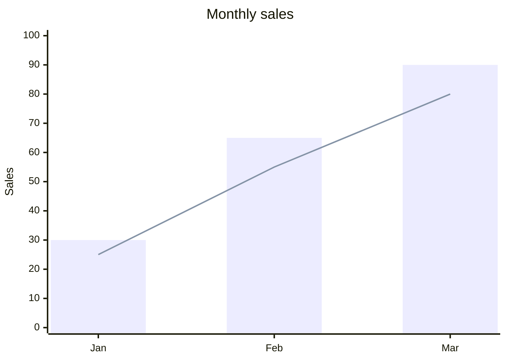
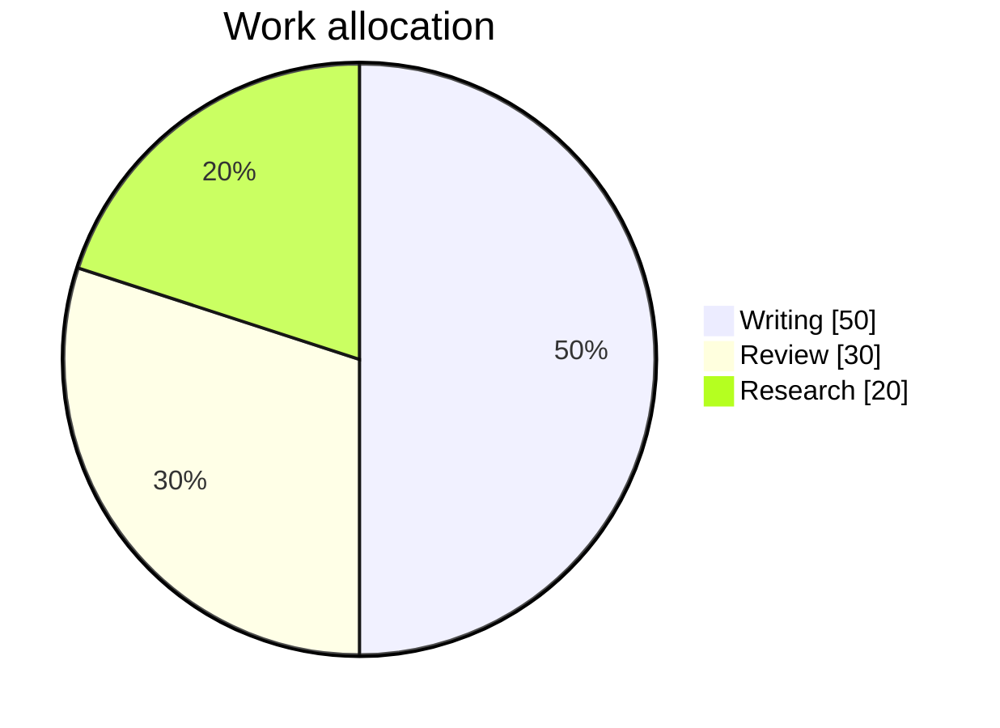

# Markdown editor research

Research date: 2026-10-30. These are implementation recommendations, not a claim that every feature below has shipped. The README describes the implemented feature set.

## What established tools provide

| Source | Verified capabilities | Practical application here |
| --- | --- | --- |
| [StackEdit](https://stackedit.io/) | Formatting controls, synchronized preview, configurable Markdown extensions, LaTeX, diagrams, emoji, offline writing, cloud synchronization | Expose the existing extensions as settings; improve the local writing workflow before adding cloud services. |
| [Dillinger official repository](https://github.com/joemccann/dillinger#features) | Local autosave, file drag and drop, Markdown/HTML/PDF export, live preview and focus mode | Make persistence and import reliable; add portable rendered HTML export and useful print output. |
| [GitHub diagram documentation](https://docs.github.com/en/get-started/writing-on-github/working-with-advanced-formatting/creating-diagrams) | Mermaid fenced blocks, including flowcharts, sequence diagrams and pie charts; separate GeoJSON, TopoJSON and STL formats | Preserve the familiar `mermaid` fence. Chart support does not require a separate chart library. |
| [remark-gfm](https://github.com/remarkjs/remark-gfm#what-is-this) | Tables, tasks, strikethrough, autolinks and footnotes; front matter and soft line breaks are separate extensions | Existing GFM already includes footnotes. Add discoverable examples and tests instead of a second footnote parser. Offer line-break behavior as a separate setting. |

StackEdit and Dillinger claims above come from their own published descriptions. This research did not run their applications or independently benchmark them.

## Chart support with the installed dependency

The project already depends on Mermaid 11.12.2 or later within major version 11. Its [version 11.12.2 XY documentation](https://github.com/mermaid-js/mermaid/blob/mermaid%4011.12.2/packages/mermaid/src/docs/syntax/xyChart.md) specifies both bar and line charts. Its [pie documentation](https://github.com/mermaid-js/mermaid/blob/mermaid%4011.12.2/packages/mermaid/src/docs/syntax/pie.md) specifies labeled numerical slices. Use versioned examples and verify them against the installed package: the public documentation site may describe a newer major version.

A useful chart fixture:

````markdown



````

Expose diagram and chart templates through existing insertion controls or the command palette. Explain supported syntax in examples rather than promising arbitrary chart formats.

## Rendering boundaries

[react-markdown](https://github.com/remarkjs/react-markdown#security) is safe by default, but custom components, plugins and URL transformations can change that guarantee. Retain its default URL filtering and escaped raw HTML. A user-facing extension switch should select a bundled, reviewed plugin; it should not evaluate JavaScript from a Markdown document.

[Mermaid security configuration](https://mermaid.js.org/config/schema-docs/config.html#securitylevel) describes `strict` mode as encoding HTML labels and disabling click behavior. The current project initially used `loose`. Prefer `strict`, suppress Mermaid's separate error rendering, and show an error inside the affected block. Verify that correcting invalid syntax recovers and that fast edits cannot display an older render over newer content.

## Proposed ten-commit scope

This order prioritizes confirmed failures and gives each commit a coherent verification target. Adjust boundaries after reproducing issues.

1. **Reliable drafts and file operations:** preserve empty documents, persist every edit path, retain filenames, and show real storage or file errors.
2. **Selection-aware editing:** apply toolbar actions at the cursor or selection and preserve undo; verify save shortcuts.
3. **Resilient Mermaid rendering:** recover from invalid syntax, handle overlapping async renders, use strict security, and load the renderer only when needed.
4. **Consistent themes:** add named light/dark palettes with persisted preferences; apply them to the app, editor, preview, dialogs, code and diagrams.
5. **Markdown extension settings:** expose GFM, math, line breaks and diagrams without arbitrary code execution; persist settings.
6. **Useful syntax and examples:** chart/diagram templates, footnotes and math examples, and a short syntax reference.
7. **Document navigation:** stable heading anchors and an outline that handles duplicate headings and ignores headings inside code fences.
8. **Export and print:** readable rendered HTML and complete print/PDF output, including when the preview is hidden.
9. **Responsive and accessible interaction:** usable narrow-screen layout, named controls, visible focus, keyboard resizing and reachable focus-mode exit.
10. **Performance and completion checks:** avoid parsing Markdown for cursor-only changes, avoid recounting the whole document unnecessarily, verify browser workflows, document support and limitations.

The ten commits can include regression tests beside the behavior they protect. A final build alone cannot verify selection, storage, diagrams, printing, or mobile interactions.

## Keep for a later iteration

Cloud synchronization, collaborative editing and comments appear in established editors, but they require account, conflict-resolution and data-retention decisions. They should be separate scoped work. Likewise, GeoJSON/STL rendering, ABC music notation and arbitrary third-party plugin installation are not implied by supporting Markdown charts. First make bundled extensions reliable and discoverable.

Local draft persistence alone does not provide offline application loading. Do not describe the editor as fully offline-capable without verifying its application-cache/service-worker behavior.
