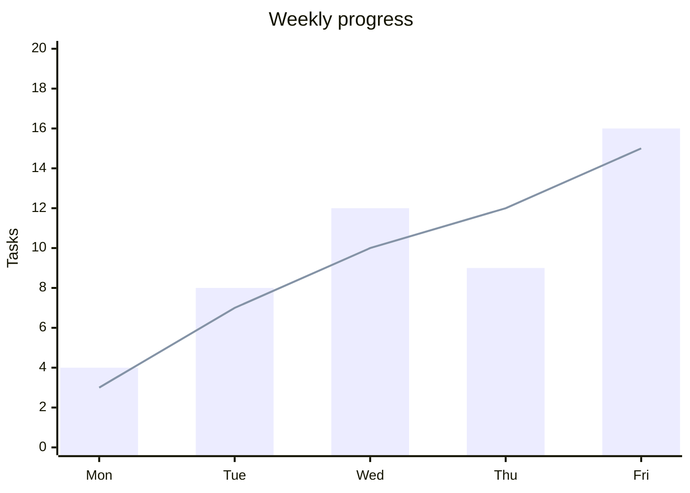
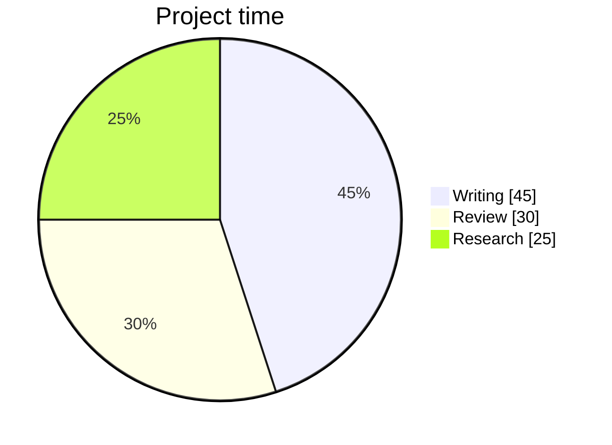

# Markdown guide

Use **Insert…** in the toolbar or the command palette (`Cmd/Ctrl+K`) for working examples. Templates insert at the cursor. They replace the current selection, so place the cursor where the example should start.

## Extensions

Open **Markdown extensions** to enable or disable GitHub Markdown, math, diagrams/charts, code highlighting, single-line breaks, and GitHub alerts. Preferences stay in this browser. Disabling an extension preserves the source.

- GitHub Markdown: tables, `~~strikethrough~~`, `- [ ]` tasks, autolinks, and footnotes (`[^name]` with a `[^name]: explanation` definition).
- Math: `$x^2$` inline, or `$$` on separate lines around an equation. Powered by KaTeX.
- Alerts: start a quote with `> [!NOTE]`, `> [!TIP]`, `> [!IMPORTANT]`, `> [!WARNING]`, or `> [!CAUTION]`.
- Code: use a fenced block with a language such as `js`, `python`, `go`, or `sql`. Unknown languages remain readable plain code.

## Diagrams and charts

Use a `mermaid` fenced block. Mermaid supports flowcharts, sequence diagrams, mind maps, Gantt charts, pie charts, and XY bar/line charts. The toolbar supplies examples; other diagram types supported by the installed Mermaid version can also be written directly.

````markdown

````

````markdown

````

Charts update after a short typing pause. Each chart has a source disclosure and an SVG download. Syntax errors stay inside the affected block; correcting the source retries rendering. Diagrams use strict security settings, so interactive callbacks and arbitrary HTML are not enabled.

Supported syntax comes from [Mermaid documentation](https://mermaid.js.org/intro/syntax-reference.html) and [KaTeX supported functions](https://katex.org/docs/supported.html). Chart.js, Vega, PlantUML and arbitrary JavaScript plugins are not installed; their fences remain source code. Raw HTML is escaped rather than executed.
